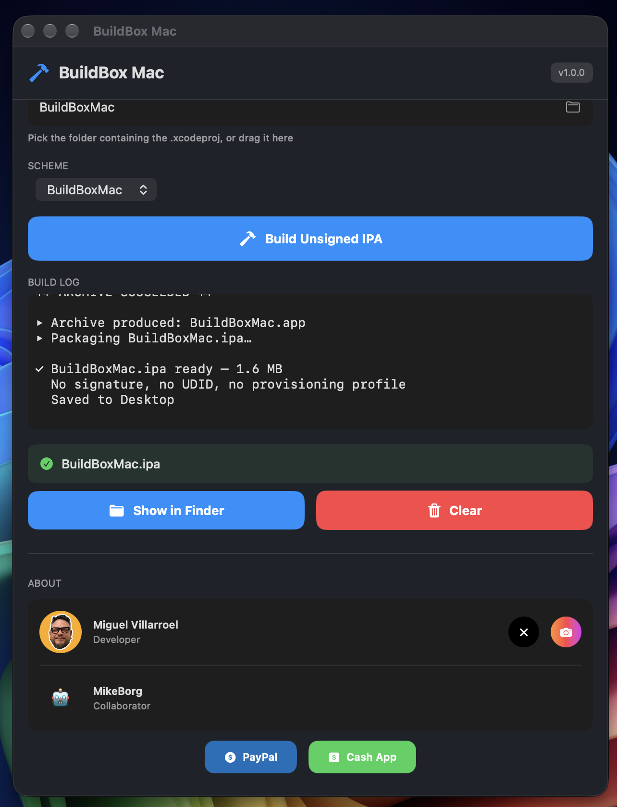

# BuildBox Mac 🔨

Build unsigned IPAs from your Xcode projects with one click. No terminal commands needed.

  

## What it does

Pick your iOS Xcode project folder, select a scheme, hit **Build Unsigned IPA** — and get a ready-to-sign `.ipa` on your Desktop.

The IPA is completely unsigned: no certificate, no provisioning profile, no UDID. Sign it yourself with [ESign](https://github.com/esign), SideStore, AltStore, or your preferred tool.

## Requirements

- macOS 13.0 or later
- Xcode installed (for `xcodebuild`)

## How to use

1. Download the `.dmg` from [Releases](https://github.com/mikevillarroel/buildbox-mac/releases).
2. Open it and drag **BuildBox Mac** to Applications.
3. In the app: select your iOS project folder (or drag it in).
4. Pick a scheme.
5. Hit **Build Unsigned IPA**.
6. Find your `.ipa` on the Desktop.

## For developers

Source code is in this repo. Open `BuildBoxMac.xcodeproj` in Xcode to build it yourself.

## Features

- 🔨 One-click unsigned IPA builds
- 📁 Drag & drop project folders
- 📋 Live build log
- 🔍 Show in Finder + Clear buttons
- 🏷️ Version auto-detected from Info.plist

## Developer

**Miguel Villarroel** — [X](https://x.com/GOT_MUNCH1ES) · [Instagram](https://instagram.com/mikevillarroel)

Collaborator: **MikeBorg**

Support development: [PayPal](https://paypal.me/mikevillarroel) · [Cash App](https://cash.app/$mikevillarroel)

## License

MIT
